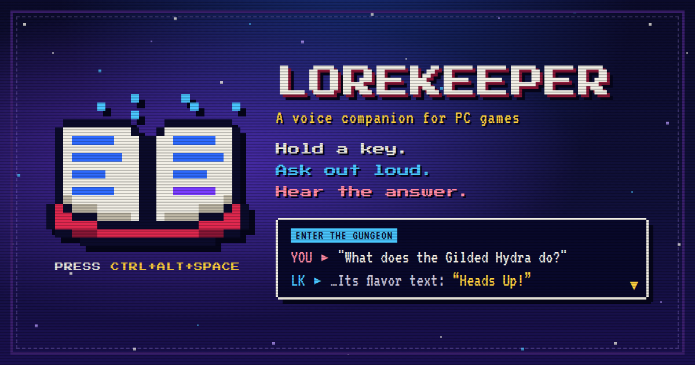

<p align="center"><a href="https://lorekeeper-cgv.pages.dev/"></a></p>

<p align="center">
  Hold <kbd>Ctrl</kbd> <kbd>Alt</kbd> <kbd>Space</kbd> in any game, ask out loud, let go.<br>
  <b>A voice companion for PC games.</b> Lore, quest steps, items and builds, even clipping the moment,<br>answered in your ear for the game you're in, <b>without spoilers</b>.
</p>

<p align="center">
  
  
  
  
  
</p>

<p align="center"><b><a href="https://lorekeeper-cgv.pages.dev/">Website</a></b> &nbsp;·&nbsp; <a href="#install">Install</a> &nbsp;·&nbsp; <a href="#just-ask">Examples</a> &nbsp;·&nbsp; <a href="#settings">Settings</a></p>

<br>

## How it works

<table>
<tr>
<td width="25%" valign="top" align="center"><br><b>1 · Hold &amp; ask</b><br><sub>Hold the hotkey and talk, or turn on listen mode and say "Lorekeeper, …". Whisper hears you <i>on your PC</i>; audio never leaves it.</sub></td>
<td width="25%" valign="top" align="center"><br><b>2 · Game detected</b><br><sub>Matched from your Steam, Epic and GOG installs. Emulator? Say "I'm playing Chrono Trigger" or pick it in the tray.</sub></td>
<td width="25%" valign="top" align="center"><br><b>3 · Wiki + Claude</b><br><sub>That game's wiki is searched directly, then Claude answers through Claude Code on the plan you already have. No API key; about 3–5 s.</sub></td>
<td width="25%" valign="top" align="center"><br><b>4 · Hear it</b><br><sub>A natural voice reads it a sentence at a time, offline. A small box shows it too, on your second monitor.</sub></td>
</tr>
</table>

## Just ask

| | You say | Lorekeeper |
|---|---|---|
| <sub>ENTER THE GUNGEON</sub> | *"What does the Gilded Hydra do?"* | What it does, then its flavor text: **"Heads Up!"** |
| <sub>ENTER THE GUNGEON</sub> | *"What synergy did I just get?"* | Reads the banner from the last few seconds of your screen, then looks it up. |
| <sub>BALDUR'S GATE 3</sub> | *"What does the Phalar Aluve do?"* | Sing or Shriek, and what each does, plus the blade's inscription. |
| <sub>DEAD BY DAYLIGHT</sub> | *"What does Dead Hard do?"* | The perk in plain words, straight from the official wiki. |
| <sub>ELDEN RING</sub> | *"Who is Ranni?"* | The lore, only up to where you are. |
| <sub>ELDEN RING</sub> | *"I just beat Margit."* | "Noted." That moves your spoiler line forward. |
| <sub>ELDEN RING</sub> | *"Where do I go next?"* | The next step. Nothing past it. |
| <sub>ELDEN RING</sub> | *"Spoil it."* | The last question again, nothing held back. |
| <sub>DIABLO IV</sub> | *"Is this better than my helm?"* | The verdict first, then the numbers that decide it, for your build. |
| <sub>ANY GAME</sub> | *"Clip it."* | Saves the last 30 seconds with Steam's recorder. |

## Why Lorekeeper

<table>
<tr>
<td width="33%" valign="top"><h3>🛡️ Spoiler-safe</h3>Progress notes per game set the line. "Where do I go" gets the next step, not the ending. It also <b>learns as you play</b>: your class, build, act and choices come from what you ask.</td>
<td width="33%" valign="top"><h3>🎙️ Listen mode</h3>No key to hold. <kbd>Ctrl</kbd>+<kbd>Alt</kbd>+<kbd>L</kbd>, then just say "Lorekeeper, …". Follow-ups right after an answer don't need the name. Chatting with friends is ignored.</td>
<td width="33%" valign="top"><h3>🧠 10-minute memory</h3>"What did that sign say two minutes ago?" works. "Remember this as the vault code" keeps a screen for good.</td>
</tr>
<tr>
<td valign="top"><h3>⚔️ Gear tracker</h3>Hover an item: "save this as my helm". Later: "is this better than my helm?" compares stat by stat. Made for Diablo; works with any tooltip.</td>
<td valign="top"><h3>🖥️ Fullscreen-proof</h3>Exclusive fullscreen is fine: the hotkey, the voice and screen capture all work. Settable hotkey, including mouse side buttons.</td>
<td valign="top"><h3>🔓 Free &amp; open</h3>Runs on the Claude plan you have, about 0.1¢ per ask. Voice and speech-to-text run on your PC. All the code is right here.</td>
</tr>
</table>

## Install

You need **Windows 10 or 11**, **Python 3.10+**, and [**Claude Code**](https://claude.com/claude-code) signed in to a Claude Pro or Max plan.

```powershell
git clone https://github.com/FindlayHi/lorekeeper
cd lorekeeper
.\setup.ps1
```

Then start **Lorekeeper** from the Start menu. It lives in the tray. Launch a game and hold <kbd>Ctrl</kbd> <kbd>Alt</kbd> <kbd>Space</kbd>.

<details>
<summary><b>🎙️ Listen mode, in detail</b></summary>
<br>

Press <kbd>Ctrl</kbd>+<kbd>Alt</kbd>+<kbd>L</kbd> (or tray → **Listen mode**, or say *"start listening"*). Start each question with **"Lorekeeper, …"**. For 8 seconds after an answer, ask a follow-up without the name. Say just *"Lorekeeper"* and it answers "Yes?" and waits.

The mic stays open, but Whisper only runs when someone's talking, so it costs almost nothing while you're quiet. It ignores everything while Lorekeeper is speaking (so it doesn't hear itself through speakers), while you hold the hotkey, and when no game is in front. Say *"stop listening"* or press the key again to turn it off.
</details>

<details>
<summary><b>⚔️ Gear tracker, in detail</b></summary>
<br>

Hover an item so its tooltip shows and say *"save this as my helm"*. Lorekeeper reads every stat into that game's gear file. Then:
- *"Is this better than my helm?"* gives the verdict first, then the two or three numbers that decide it, for your build. Gear math uses Sonnet.
- *"What's my gear?"* lists what's saved. *"Forget my second ring"* removes one.

Slots understand the usual words: helmet or head, chest piece, off hand, second ring, and so on.
</details>

<details>
<summary><b>🧠 Memory and notes, in detail</b></summary>
<br>

- **Screen:** the last 5 seconds at one frame a second, plus 10 minutes at one frame every 10 seconds, in memory only. "Just", "two minutes ago" and "earlier" choose which frames go with your question.
- **Saved screens:** *"Remember this as the vault code"* keeps it on disk for that game; *"what was the vault code?"* brings it back.
- **Notes:** *"I just beat Margit"*, *"I'm in Act 2"* or *"note: I sided with the Emperor"* are saved at once, with no AI. Lasting facts your questions reveal are noted too.

Everything per game is a plain file you can edit, in `%APPDATA%\Lorekeeper\games\`: `<game>.md` (notes), `<game>.gear.json`, and `<game>/saved/`.
</details>

<details>
<summary><b>⚙️ Settings</b></summary>
<br>

<a id="settings"></a>Most settings are in the tray: game, hotkey, listen key, voice, spoilers, box and screen. Everything else is in tray → **Settings file** (`%APPDATA%\Lorekeeper\config.json`):

| Key | Default | |
|---|---|---|
| `hotkey` | `ctrl+alt+space` | hold to talk; any key, combo, or `mouse4`/`mouse5` |
| `hotkeyEverywhere` | `false` | off: the hotkey only works while a game is in front, so Atticus can share it |
| `listen` / `listenKey` | `false` / `ctrl+alt+l` | listen mode and its on/off key |
| `followUpSeconds` | `8` | how long after an answer a follow-up needs no name |
| `clipKeys` | `ctrl+f10` | in Steam → Settings → Game Recording, set **Save the last 30 seconds** to <kbd>Ctrl</kbd>+<kbd>F10</kbd>. Or use `win+alt+g` for Game Bar |
| `kokoroVoice` | `af_nicole:0.5,bf_isabella:0.5` | tray → **Voice**, or any [Kokoro voice](https://huggingface.co/hexgrad/Kokoro-82M/blob/main/VOICES.md) or blend |
| `voice` | `kokoro` | `edge` = Microsoft online voices; `sapi` = Windows' robotic one |
| `model` / `deepModel` | `haiku` / `sonnet` | say "in detail" or "tell me more" for the deep one |
| `whisper` / `whisperDevice` | `base.en` / `cpu` | `small.en` hears names better; `cuda` with an NVIDIA GPU |
| `spoilers` / `screen` | `false` / `true` | also in the tray |
</details>

<details>
<summary><b>🧩 Gotchas</b></summary>
<br>

- **Game running as admin?** Windows keeps its keys from non-admin apps, so run Lorekeeper as admin too.
- **Exclusive fullscreen** covers the box on that screen, but the voice still works. If a game shows black to screen capture, Lorekeeper says so and goes by your words.
- **Anti-cheat:** Lorekeeper reads the screen the way Discord and OBS do, and watches one hotkey like push-to-talk. It never touches the game's memory or files. "Clip it" sends one key press, to Steam.
- **Wikis:** each game's own wiki is searched directly (wiki.gg, Fandom, bg3.wiki and more). New games get their wiki found and remembered on first use.
</details>

<details>
<summary><b>⌨️ Command line</b></summary>
<br>

```
python lorekeeper.py --ask "what does the casey do"   # typed, printed, for the game in front
python lorekeeper.py --games                          # installed games it knows
python lorekeeper.py --voices                         # sample wavs of every voice
```
</details>

<br>

<p align="center"><sub>Lorekeeper is free and open source. Not affiliated with Anthropic or any game publisher.</sub></p>
